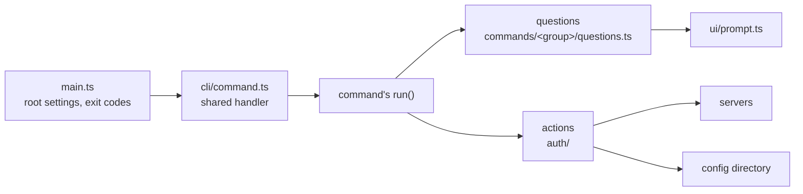

# dh — Architecture

How the `dh` source is organized, and the conventions for adding commands.
Setup, tests and releases are in the [Developer Guide](DEVELOPER_GUIDE.md).

## Commands are questions and actions

A command's `run` function is a short script. Each step is either a question or
an action:

|              | Does                                                    | Takes                                     | Returns                           | Doesn't                                     |
| ------------ | ------------------------------------------------------- | ----------------------------------------- | --------------------------------- | ------------------------------------------- |
| **Question** | Gets an answer from a flag, env var, stdin, or a prompt | `ctx.ui`, the command's flags, plain data | plain data                        | call a server or write the config directory |
| **Action**   | Calls servers and reads or writes the config directory  | plain data                                | plain data, or throws a `DhError` | prompt                                      |

`run` returns an `Output`. The shared handler prints it and turns errors into
exit codes, so commands don't do either.

`dh auth login` ([login.ts](../src/commands/auth/login.ts)) runs:

```text
askLoginTarget → trustAndResolveServer → connectServer → offeredMethods
  → askSignInMethod → askSignInCredentials → signIn → confirmSsoAccount
  → askMakeDefault → commitSignIn → Output
```

Reading `run` tells you what a command does, and a change in behavior shows up
as a changed line there. The details are one call down.

Because actions take plain data, it doesn't matter where the answers came from.
`dh auth migrate` reads them from an old config file and calls the same `signIn`
and `commitSignIn` as login. Saved profiles and `DH_*` environment variables
also go through `signIn`, so a new sign-in method needs one case in
`askSignInCredentials` and one in `signIn`. Code outside the CLI, like an MCP
tool, could call the actions the same way. Actions can be tested without a
terminal, and questions with a fake `Prompter`.

Every prompt names the flag that answers it. With `--no-prompt` or no terminal,
the question fails with that flag in the error message.

Login asks every question before uploading a key. If the user presses Ctrl-C at
"Make this the default?", nothing has been written. Other commands should do the
same: ask everything before the first step that can't be undone.

The shared handler provides help, `-o json`, `--profile`, `--no-prompt`, error
codes, and the `dh agents` listing. A new command gets all of them, and a new
global flag reaches every command.

## Layout



| Path                                                                 | Holds                                                                                 | Imports                                |
| -------------------------------------------------------------------- | ------------------------------------------------------------------------------------- | -------------------------------------- |
| [src/main.ts](../src/main.ts)                                        | Root command settings; turns any thrown error into an exit code                       | everything below                       |
| [src/cli/](../src/cli/)                                              | `defineCommand`, `Context`, `Output`, the global flags; `readSecret` for secret flags | `ui`, `output`, `errors`, `auth/store` |
| [src/output.ts](../src/output.ts), [src/errors.ts](../src/errors.ts) | The only writer to stdout/stderr; `DhError` and the error codes                       | `output` imports `errors`              |
| [src/ui/](../src/ui/)                                                | The `Prompter` interface and its Ink implementation                                   | `errors`                               |
| [src/commands/](../src/commands/)                                    | One file per command, plus each group's `questions.ts`                                | `cli`, actions                         |
| [src/auth/](../src/auth/)                                            | Auth actions: sign-in, profiles, keys, the config store                               | `errors`, `output`                     |

Imports go down the table. `cli/`, `output.ts`, `errors.ts` and `ui/` are shared
by every command and contain nothing auth-specific, except that `Context.store`
is the profile store from `auth/store.ts`; every command signs in with a
profile. Actions for a new area, such as running queries, would go in a folder
beside `auth/`.

## Adding a command

Create `src/commands/<group>/<name>.ts`:

```ts
export const status = defineCommand({
  name: "status",
  description: "Check the profile against its server.",
  async run(ctx) {
    const session = await requireAuth(ctx.profileFlag, ctx.store);
    disconnectServer(session);
    return {
      human: `✔ Logged in to ${session.origin} as ${session.user}`,
      json: { server: session.origin, user: session.user },
    };
  },
});
```

Then add it to its parent's `commands` list
([auth/index.ts](../src/commands/auth/index.ts) or
[root.ts](../src/commands/root.ts)).

Arguments and options go on the spec as `args` and `options` (commander
`Option`s). `run` receives `(ctx, args, opts)`, with `opts` typed by
`defineCommand<MyOptions>`. A command that talks to a server starts with
`requireAuth(ctx.profileFlag, ctx.store)`.

## Writing questions and actions

A question returns the flag's value if one was given, then the only sensible
answer if there is one, and otherwise asks. It passes the answering flag to the
prompt: `ui.select(message, choices, "--method")`. Reading files and env vars
the user pointed to is fine.

An action can print progress with `note(...)`. Anything the command might show
differently, like warnings, is returned instead.

Errors are `DhError(code, message, hint?, reason?)`, caught only in
[main.ts](../src/main.ts). New codes go in [errors.ts](../src/errors.ts) and
show up in `dh agents`.

`Output.human` is for people and `Output.json` for `-o json`. In JSON mode,
stdout carries only the result and everything else goes to stderr.

Human lines and notes stay plain text. On a terminal,
[output.ts](../src/output.ts) colors a leading `✔`, `✖` or `!`, dims `…`
progress lines, and colors `` `commands` `` in backticks and a URL alone on its
line.

Keep lines short, since names and URLs make them long fast. Put a reason, a hint
or a detail on its own indented line under the main line. A `DhError`'s `hint`
and `detail` print that way already.

## Keeping functions readable

A function's doc comment says what it does, and its body should show how without
reading the functions it calls. When a function gets long, split it into named
steps; when a step can't be split usefully, give it a one-line comment saying
why it's there.

A ternary can't contain another ternary, even inside an object or template in
one of its branches. Use early returns, a `switch`, or a small named function.
Biome's `noNestedTernary` catches the direct cases; reviewers catch the rest.

## Naming

Names should make sense where they're called, not just where they're defined.

- Questions start with `ask` or `confirm` and name the answer:
  `askSignInMethod`, `askMakeDefault`, `confirmSsoAccount` (rather than
  `askMethod`).
- Actions are a verb and an object: `connectServer`, `commitSignIn`,
  `removeProfiles`, `trustAndResolveServer` (rather than `connect` or `open`).
- Data types name what they hold: `SignInRequest`, `ProfileToSave`,
  `OfferedMethod`, `PriorSignIn` (rather than `how`, `known` or `recipe`).
- Shared modules don't use auth terms.

## Review checklist

- `run` is a list of questions and actions, with no prompts or server calls
  written inline.
- Actions don't take a `Prompter`, and questions don't call servers.
- New prompts name their flag, and the flag works without a terminal.
- `bun run check` and `bun test` pass.
- [AUTH.md](AUTH.md) covers any change in how `dh auth` behaves.
