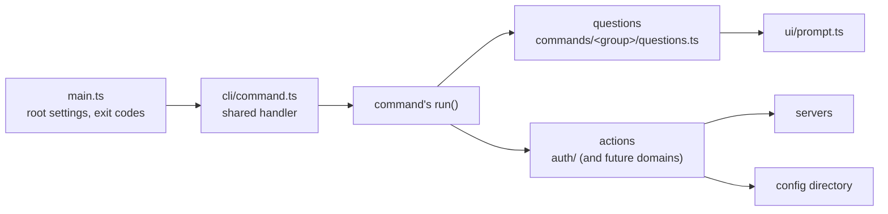

# dh — Architecture

How `dh` is put together, and the rules that keep it simple. Read this before
adding or changing a command. Setup, tests and releases are in the
[Developer Guide](DEVELOPER_GUIDE.md).

## The one rule: questions, then actions

Every command's `run` is a short script that reads top to bottom, alternating
two kinds of step:

| Step         | What it does                                      | Takes                                     | Returns                           | Never                                              |
| ------------ | ------------------------------------------------- | ----------------------------------------- | --------------------------------- | -------------------------------------------------- |
| **Question** | Gets an answer from flags, env, stdin or a prompt | `ctx.ui`, the command's flags, plain data | plain data                        | touches the network or writes the config directory |
| **Action**   | Does the work                                     | plain data                                | plain data, or throws a `DhError` | sees a `Prompter` or asks anything                 |

`run` then returns an `Output`, and the shared handler prints it. Commands don't
print results, parse global flags, or pick exit codes themselves.

`dh auth login`, for example ([login.ts](../src/commands/auth/login.ts)):

```text
askLoginTarget → trustAndResolveServer → connectServer → offeredMethods
  → askSignInMethod → askSignInCredentials → signIn → confirmSsoAccount
  → askMakeDefault → commitSignIn → Output
```

Why it matters:

- **Readable:** the script is the summary. Details live one level down, in a
  function whose name says what it does.
- **Extensible:** a new command is one file and one line in its parent's
  `commands`. A new sign-in method is one case in `askSignInCredentials` and one
  in `signIn`; every caller (login, saved profiles, env vars, migrate) gets it.
  Behavior added to the shared handler, like a global flag or output format,
  reaches every command at once.
- **Reusable:** actions don't care where answers came from. `migrate` feeds
  login's actions from an old config file instead of prompts; saved profiles and
  `DH_*` environment variables use the same `signIn`. Something other than the
  CLI, such as an MCP tool, could call the same actions with its own inputs.
- **Testable:** actions take and return plain data, so they're tested without a
  terminal. Questions only need a `Prompter`, which is an interface and easy to
  fake.
- **Consistent:** help, `-o json`, `--no-prompt`, error codes and `dh agents`
  come from the shared handler, so every command behaves the same and agents can
  rely on it.
- **Safe to cancel:** ask every question before the first irreversible action.
  Login asks "Make this the default?" before uploading a key, so Ctrl-C never
  leaves one behind.
- **Scriptable:** every prompt names the flag that answers it. Without a
  terminal or with `--no-prompt`, the question fails with that flag in the
  error.
- **Reviewable:** a change in what a command does shows up as a changed line in
  its `run`, not buried in a helper.

## Layout



| Path                                                                 | Holds                                                                                 | Depends on                             |
| -------------------------------------------------------------------- | ------------------------------------------------------------------------------------- | -------------------------------------- |
| [src/main.ts](../src/main.ts)                                        | Root command settings; turns any thrown error into an exit code                       | everything below                       |
| [src/cli/](../src/cli/)                                              | `defineCommand`, `Context`, `Output`, the global flags; `readSecret` for secret flags | `ui`, `output`, `errors`, `auth/store` |
| [src/output.ts](../src/output.ts), [src/errors.ts](../src/errors.ts) | The only writer to stdout/stderr; `DhError` and the stable error codes                | `output` → `errors`                    |
| [src/ui/](../src/ui/)                                                | The `Prompter` interface and its Ink implementation                                   | `errors`                               |
| [src/commands/](../src/commands/)                                    | One file per command, plus each group's `questions.ts`                                | `cli`, actions                         |
| [src/auth/](../src/auth/)                                            | Auth actions: sign-in, profiles, keys, the config store                               | `errors`, never `commands` or `ui`     |

Dependencies point down the table. `cli/`, `output.ts`, `errors.ts` and `ui/`
are shared by every command and must not mention auth. The one exception is
`Context.store`, the profile store from `auth/store.ts`, since every command
signs in with a profile. A new domain (say, running queries) gets its own folder
of actions beside `auth/`.

## Adding a command

1. Create `src/commands/<group>/<name>.ts`:

   ```ts
   export const status = defineCommand({
     name: "status",
     description: "Check the profile against its server.",
     async run(ctx) {
       const session = await requireAuth(ctx.profileFlag, ctx.store); // action
       disconnectServer(session); // action
       return {
         human: `✔ Logged in to ${session.origin} as ${session.user}`,
         json: { server: session.origin, user: session.user },
       };
     },
   });
   ```

2. Add it to the parent's `commands` list
   ([auth/index.ts](../src/commands/auth/index.ts) or
   [root.ts](../src/commands/root.ts)).

That's all. Help, `-o json`, `--profile`, `--no-prompt` and `dh agents` work
automatically. Anything that talks to a server starts with
`requireAuth(ctx.profileFlag, ctx.store)`.

Arguments and options are declared on the spec (`args`, `options` with commander
`Option`s); `run` receives them as `(ctx, args, opts)`, with `opts` typed by
`defineCommand<MyOptions>`.

## Writing questions and actions

- **A question** takes `ctx.ui`, the flags and plain data. It returns the flag's
  value if given, else the only sensible answer, else asks. Each prompt passes
  the flag that answers it (`ui.select(message, choices, "--method")`). Reading
  the user's own files and env vars is fine; network calls and config writes are
  not.
- **An action** takes plain data and returns plain data. Progress lines
  (`note(...)`) are fine; anything the script may want to show differently, like
  warnings, is returned instead.
- **Errors** are `DhError(code, message, hint?, reason?)`, thrown and caught in
  one place ([main.ts](../src/main.ts)). Add new codes to
  [errors.ts](../src/errors.ts); they appear in `dh agents` automatically.
- **Output:** results go in the returned `Output`: `human` for people, `json`
  for `-o json`. stdout carries only the result; everything else goes to stderr
  in JSON mode.

## Naming

Names say what they do, even read outside their file.

- **Questions** start with `ask` or `confirm` and name the answer:
  `askSignInMethod`, `askMakeDefault`, `confirmSsoAccount`. Not `askMethod`.
- **Actions** are verbs with an object: `connectServer`, `commitSignIn`,
  `removeProfiles`, `trustAndResolveServer`. Not `connect` or `open`.
- **Data** is named for what it is: `SignInRequest`, `ProfileToSave`,
  `OfferedMethod`, `PriorSignIn`. No `how`, `known`, `item`, `recipe` or `spec`.
- Shared modules use no domain words in names or comments.

## Before you merge

- `run` reads as a list of questions and actions, with no prompting or network
  code inline.
- No action takes a `Prompter`; no question makes a network call.
- Every new prompt names its flag, and the flag works without a terminal.
- `bun run check` and `bun test` pass.
- Behavior changes to `dh auth` are reflected in [AUTH.md](AUTH.md).
