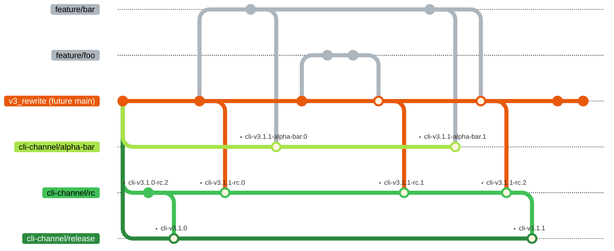
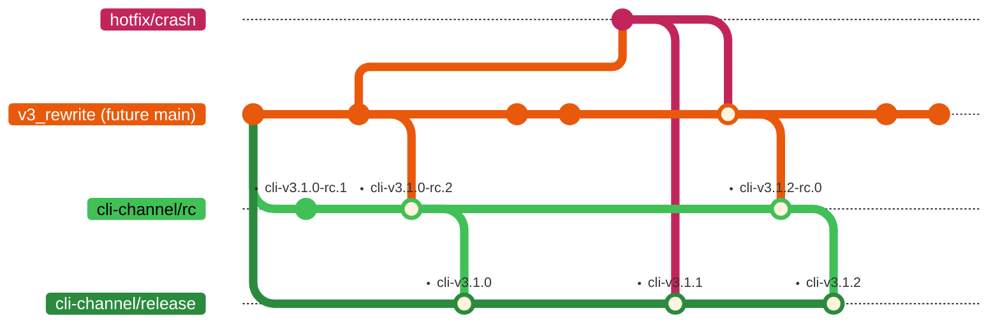
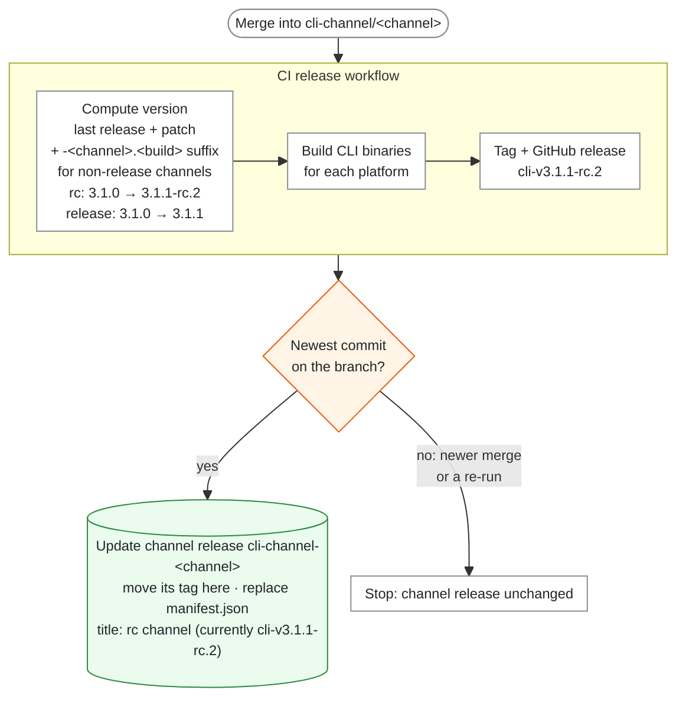
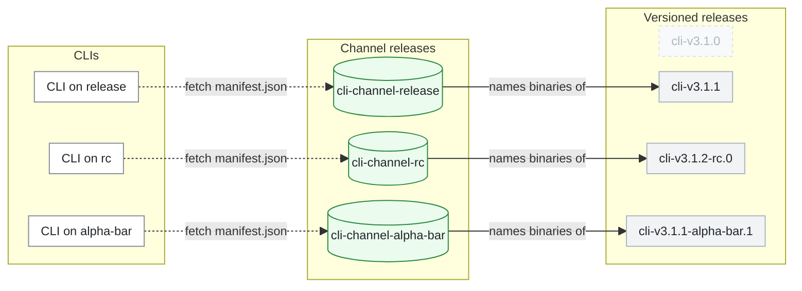

# Release architecture

How CLI builds are versioned, published and picked up by installed CLIs.

A **channel** is a named stream of CLI builds, such as `release` or `rc`; each install follows one and auto-updates to its latest build. Each channel has its own protected git branch, and merging into the branch publishes to that channel. CI creates the version tag and GitHub release, and the CLI installs from whatever channel it points at.

Using channels as a user is covered in [Release channels](CHANNELS.md); the one-time repo setup and testing on a fork are in the [Developer Guide](DEVELOPER_GUIDE.md#releasing).

## At a glance

| Channel | Branch | Who follows it | Fed by |
| --- | --- | --- | --- |
| `release` | `cli-channel/release` | Everyone (default) | Promoting `rc`, or a hotfix |
| `rc` | `cli-channel/rc` | Testers who opt in | Merges from `v3_rewrite` |
| `alpha-<id>` | `cli-channel/alpha-<id>` | Testers of one experiment | Merges from that feature branch |

- **Merging starts a publish.** Every merge or push to a channel branch triggers CI, which builds and publishes it; `release` publishes only a merged `rc` or hotfix PR. Nothing is released from a local machine.
- **The CLI follows one channel:** the one saved at install or with `dh channel use`, else `release`. It installs the channel's latest build whenever that version differs from the one running.
- **Releases always come from the `rc` channel.** The one exception is a hotfix, which goes straight into `release` and is then merged into `v3_rewrite` and on to `rc`, so the next promotion includes it (see [Hotfixes](#hotfixes)).
- **CI computes every version.** People only edit `package.json` to bump minor or major.
- **Every publish creates a GitHub release.** On the `release` channel it's a regular release tagged `cli-vX.Y.Z`, but not marked latest, since v2 currently uses `releases/latest` for its own process. On every other channel it's a pre-release tagged `cli-vX.Y.Z-<channel>.<build>`.

## Branches

Feature branches merge into `v3_rewrite`; once the rewrite lands, that role moves to `main` and nothing else here changes. `v3_rewrite` merges into `rc`, and `rc` is promoted to `release`. An experiment (`feature/bar`) can publish to its own `alpha-<id>` channel before it lands.



### Hotfixes

A hotfix is the one release that doesn't come from `rc`. Fix the released code, then merge the fix forward ("merge upwards", as in git's own workflow).



1. Branch `hotfix/<name>` from the last released `v3_rewrite` commit: `git merge-base origin/cli-channel/release origin/v3_rewrite`. If an earlier hotfix hasn't been merged into `v3_rewrite` yet, do step 3 for it first; otherwise the new branch lacks that fix and `release-contains` rejects it.
2. PR it into `release`. It ships as `3.1.1`.
3. Merge it into `v3_rewrite`, then `v3_rewrite` into `rc` as usual.
4. Promote `rc` as usual. Until the fix reaches `rc`, `release-contains` blocks the promotion, so a hotfix can't be left out by accident.

## What a publish does

A publish starts when something is merged or pushed to a `cli-channel/<channel>` branch; nothing else publishes. On `release`, the workflow first checks that the pushed commit is the merge of a PR from `cli-channel/rc` or `hotfix/*`, and publishes nothing otherwise (see [Rules](#rules)). Each publish updates two GitHub releases:

- **Versioned release** (`cli-v3.1.1-rc.2`, `cli-v3.1.1`): created new, never changed afterwards. Holds the binaries, `manifest.json`, `SHA256SUMS` and the install scripts. Created with `--latest=false`, so `releases/latest` stays with the Python MCP releases.
- **Channel release** (`cli-channel-rc`, `cli-channel-release`): one per channel, same name forever, created on the channel's first publish. Each publish moves its tag to the published commit, replaces its `manifest.json` to point at the new versioned release, and updates its title to show the current build, for example `rc channel (currently cli-v3.1.1-rc.2)`. The `release` channel's release also carries `install.sh` and `install.ps1`, which the install one-liners download. GitHub dates a release by its tag's commit, so the channel release sits next to its current build on the Releases page.

Every channel runs the same steps:



- **The newest-commit check** stops a slower run, or a re-run of an old one, from pointing a channel back at an older build. That build still gets its versioned release.

## How the CLI updates

The CLI never talks to CI or to branches. It only reads the GitHub release for its channel.



Each CLI's channel comes from its `dh.meta`, else `release`. Channel releases keep their names forever while their tag and manifest move on each publish; versioned releases never change. `cli-v3.1.0` is an older release that no channel release names anymore: it can still be downloaded, but no CLI updates to it.

1. **Pick a channel:** `channel` in the install metadata file, else `release`.
2. **Check after a command finishes, at most once per `DH_UPDATE_INTERVAL`** (default 24 hours; never with `DH_AUTO_UPDATE=off`): fetch `releases/download/cli-channel-<channel>/manifest.json`.
3. **If the manifest's version differs from its own,** download the binary for this platform, verify its SHA-256, and replace itself, unless `dh.meta`'s channel changed meanwhile (a `dh channel use` in another terminal). The check and the swap happen under the same lock that guards `dh.meta`, so the installed build always matches the saved channel.

- **No higher-or-lower comparison.** Any difference installs, so switching channels can move to a lower version.
- **Install on a channel:** `curl -fsSL https://github.com/deephaven/deephaven-mcp/releases/download/cli-channel-release/install.sh | DH_CHANNEL=rc sh`. The script installs that channel's latest build and saves the channel in the metadata file. `DH_CHANNEL` is read only by the install script; the CLI ignores it. Any copy of the script behaves the same; without `DH_CHANNEL` it installs `release`. An unpublished channel fails with "no channel", and an invalid name fails before anything downloads.
  - **Try a channel side by side:** install a second copy elsewhere, for example `DH_CHANNEL=rc DH_INSTALL_DIR=~/dh-rc`. It gets its own metadata file, so the main install keeps its channel.
- **Switch an existing install:** `dh channel use <channel>` follows the CLI's noun + `use` pattern (`dh auth use <profile>`).
  1. Checks the channel: one that hasn't been published fails with `channel_not_found`, and nothing is saved.
  2. Saves the channel in `dh.meta`.
  3. Installs the channel's build now if its version differs, ignoring the interval and `DH_AUTO_UPDATE`. If the download fails, the channel stays saved and installs at the next check.

  Run on the channel already followed, it's a manual update; on a pinned install, it moves to the channel's current build, which stays put while `DH_AUTO_UPDATE=off` is still set. `dh channel use release` switches back. Dev builds refuse `dh channel use`.
- **Show the channel:** `dh channel` prints the channel the install follows. If the running build is from another channel, it names both and gives the `dh channel use` command to fix it; on a dev build it prints `dev (never updates)`.
- **Pinning a version:** install it with `DH_INSTALL_VERSION` (any channel's version; it downloads that `cli-v…` release directly) and set `DH_AUTO_UPDATE=off`. Both are needed: without the second, the next command updates to the channel's build.
- **Install metadata file:** one file next to the binary, named after it: `dh.meta` beside `dh`, `dh.exe.meta` beside `dh.exe`. It's a JSON object of install-level data, such as the channel and the last update-check time, with no extension because it isn't meant to be edited by hand. The install script writes it fresh, so its format is a contract between the scripts and the CLI; the CLI and updater each update only their own fields, writing to a temp file and renaming it into place. An unreadable file means defaults (`release`, check now), never a failed command.
- **Dev builds never update.** A CLI run from source or built locally reports channel `dev`, never checks for updates and refuses `dh channel use`, so it can't be replaced by a published build.
- **A failed check is harmless.** Replacing the manifest returns 404 for a moment; the CLI just checks again next interval.
- **Help shows a non-release channel.** Top-level help prints `Version:` under `Usage:`. On any build other than `release`, it adds a `Channel:` line with the build's channel and config folder, for example `Channel: rc (config ~/.deephaven/cli-rc)`, or `Channel: dev (config ~/.deephaven/cli-dev)` on a dev build. Release builds show nothing extra.

## Config per channel

Each channel keeps its own config folder (profiles and credentials), so an `rc` or alpha build that changes the config format can't break a working `release` setup.

| Build | Config folder |
| --- | --- |
| `release` | `~/.deephaven/cli` (`%APPDATA%\Deephaven\cli` on Windows) |
| Any other channel | A sibling folder: `~/.deephaven/cli-rc`, `~/.deephaven/cli-alpha-bar`, … |
| Dev build (`bun run dev`, or a local `bun run build`) | `~/.deephaven/cli-dev` |

- **The build decides, not `dh.meta`.** The channel is baked into the binary at build time, like the version, so a channel's folder is only ever read and written by that channel's code. Switching channels switches folders when the new channel's build installs, not when `dh.meta` changes.
- **Each channel starts empty.** Testers sign in once per channel. A channel only manages credentials it created, so logging out on `rc` never revokes a key `release` uses.
- **`DH_CONFIG_DIR` overrides the folder** for every channel. Builds that share a value share one config and lose the isolation above: an `rc` build can change the config format a `release` build reads, and logging out on one channel revokes keys the other uses.

## Versions

CI computes every version from the tags already in the repo plus `package.json`. Nobody edits versions for a normal release.

1. **Base `X.Y.Z`:** the last release (the highest `cli-vX.Y.Z` tag) + patch, or `version` in `package.json` if that is higher.
2. **Suffix,** on every channel except `release`: `-<channel>.<build>`, where `<build>` counts up from 0 for each `X.Y.Z` and channel.

| Publish (last release `3.1.0`) | Result |
| --- | --- |
| Merge into `rc` | `3.1.1-rc.0` |
| Merge into `rc` again | `3.1.1-rc.1` |
| Merge into `alpha-bar` | `3.1.1-alpha-bar.0` |
| Promote `rc` to `release` | `3.1.1` |
| Next merge into `rc` | `3.1.2-rc.0` |

### Minor and major bumps

Patch bumps are automatic. For a minor or major bump, a PR sets `version` in `package.json`, normally the same PR as the change that needs it:

1. A PR into `v3_rewrite` sets `package.json` to `3.2.0` (or `4.0.0`). Nothing publishes yet.
2. Merging `v3_rewrite` into `rc` publishes `3.2.0-rc.0`, so `rc` labels jump from `3.1.x`.
3. Promoting `rc` to `release` publishes `3.2.0`.
4. Patches then continue automatically (`3.2.1-rc.0`, …). `package.json` stays at `3.2.0` until the next bump.

- **`package.json` is a minimum.** The default is to bump the last release by one patch, unless `package.json` has a higher version, in which case that version becomes the next release. This allows bumping the major or minor version in `package.json` to set the floor for subsequent releases.
- **Branches made before the bump keep their old `package.json`.** An `alpha-<id>` channel stays on `3.1.x` labels until its feature branch merges `v3_rewrite` or `3.2.0` is released; after that the last release sets the minimum, so its builds read `3.2.1-alpha-<id>.N`. A breaking feature can bump `package.json` on its own branch, so its alpha builds read `4.0.0-alpha-bar.N`.
- **A hotfix is a patch on the current release.** With `3.1.0` released and `v3_rewrite` already bumped to `3.2.0`, a hotfix ships as `3.1.1`: its branch starts from the released commit, where `package.json` is still `3.1.0`. The bump arrives later through `rc` as `3.2.0-rc.0`.

### Labels and names

- **A pre-release version is a guess at the release it leads to.** `3.1.1-rc.1` means "would be `3.1.1` if released now". If a hotfix ships `3.1.1` first, the rc work is released as `3.1.2`, so the `3.1.1-rc.N` builds never became `3.1.1`. That's harmless: CLIs only check whether a version differs, never which is higher.
- **Channel names match `^[a-z][a-z0-9-]*$`.** Hyphens are fine: `3.1.1-alpha-bar.0` is valid semver. `dev` is reserved for builds run from source or built locally.

## Rules

| Rule | Enforced by |
| --- | --- |
| Channels only move forward | Branch ruleset on `cli-channel/**`: no force-push, no deletion |
| Who can publish | Standard repo permissions: anyone with write access can merge into a channel branch, including creating an `alpha-<id>` one |
| `release` only takes a reviewed PR from `rc` or a hotfix | Ruleset on `cli-channel/release`: an approving review is required, and it's the sign-off. Required status check `release-source`: the PR must come from this repo's `cli-channel/rc` or a `hotfix/*` branch, not a fork's. The release workflow: publishes only if the pushed commit is the merge of such a PR, so a stray direct push never reaches users |
| A release never leaves out a released commit | Required status check `release-contains` |
| Channel branches keep their history | Branch ruleset on `cli-channel/**`: changes go through a PR (no approval needed outside `release`) merged with a merge commit, never squash or rebase. The source branch stays an ancestor, so each merge's diff shows only what's new and `release-contains` can find hotfixes. Feature PRs into `v3_rewrite` still squash |
| Version tags never change | Tag ruleset on `cli-v*`: no update, no deletion |
| Only CI moves channel tags | Tag ruleset on `cli-channel-*`: no update or deletion, except by the release workflow |

Merging publishes; there's no separate deployment approval after the PR's review. Repo admins can bypass these rules, but an accidental direct push to `release` still won't publish: the workflow only publishes merged `rc` or hotfix PRs.

`release-contains` fails a release PR if the branch is missing any change already on `release`. It matches commits by patch, so cherry-picked fixes count. It doesn't catch a fix undone by a later conflict resolution:

```sh
git log --no-merges --cherry-pick --right-only --format='%h %s' HEAD...origin/cli-channel/release
```

## Where it lives

| Piece | Code |
| --- | --- |
| Channel names, `cli-v` tags, next version, release-notes start | [src/channel.ts](../src/channel.ts), [scripts/next-version.ts](../scripts/next-version.ts) |
| Build (channel baked in with `--define`) | [scripts/build.ts](../scripts/build.ts), [scripts/release.ts](../scripts/release.ts), [src/version.ts](../src/version.ts) |
| Publishing the versioned and channel releases | [scripts/publish.ts](../scripts/publish.ts), [.github/workflows/release.yml](../.github/workflows/release.yml) |
| `release-source` and `release-contains` | [.github/workflows/release-checks.yml](../.github/workflows/release-checks.yml) |
| Update checks and installs | [src/updater.ts](../src/updater.ts) |
| `dh.meta` | [src/install-meta.ts](../src/install-meta.ts) |
| `dh channel`, `dh channel use` | [src/commands/channel/](../src/commands/channel/) |
| Config folder per channel | `configDir()` in [src/actions/auth/store.ts](../src/actions/auth/store.ts) |
| Installing on a channel | [install.sh](../install.sh), [install.ps1](../install.ps1) |

The manifest format (`Manifest` in `src/updater.ts`), the channel release URL and the `dh.meta` format are read by every shipped CLI and by the install scripts, so changes to them must stay backward compatible.
